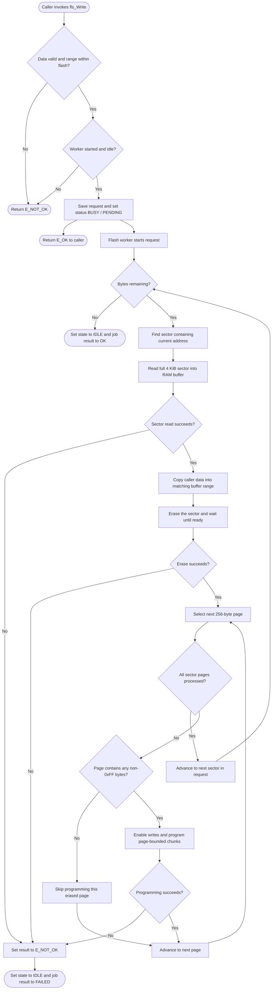

# `fls_Write()` activity diagram

`fls_Write()` returns after the worker accepts the request. The source buffer
must remain valid until `fls_GetStatus()` reports `FLS_IDLE`; then inspect
`fls_GetJobResult()` to determine whether the write succeeded. Only one job can
be active at a time. The worker preserves bytes outside the requested range by
buffering and rewriting each affected sector. Power loss or an I/O failure
after erase can still lose data in that sector. The 4 KiB sector buffer is
static RAM.
