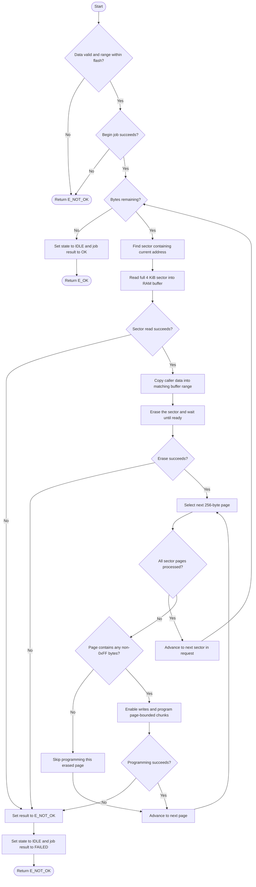

# `fls_Write()` activity diagram

`fls_Write()` preserves bytes outside the requested range by buffering and
rewriting each affected sector. The sector is erased before it is restored, so
power loss or an I/O failure during that interval can still lose data in that
sector. The 4 KiB sector buffer is static RAM.
